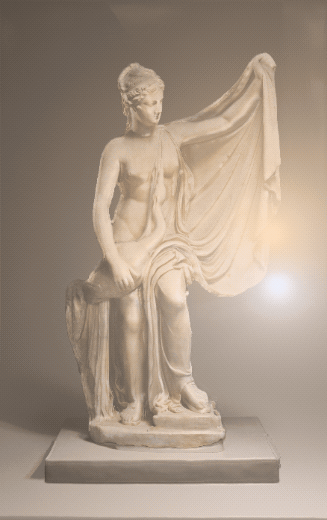
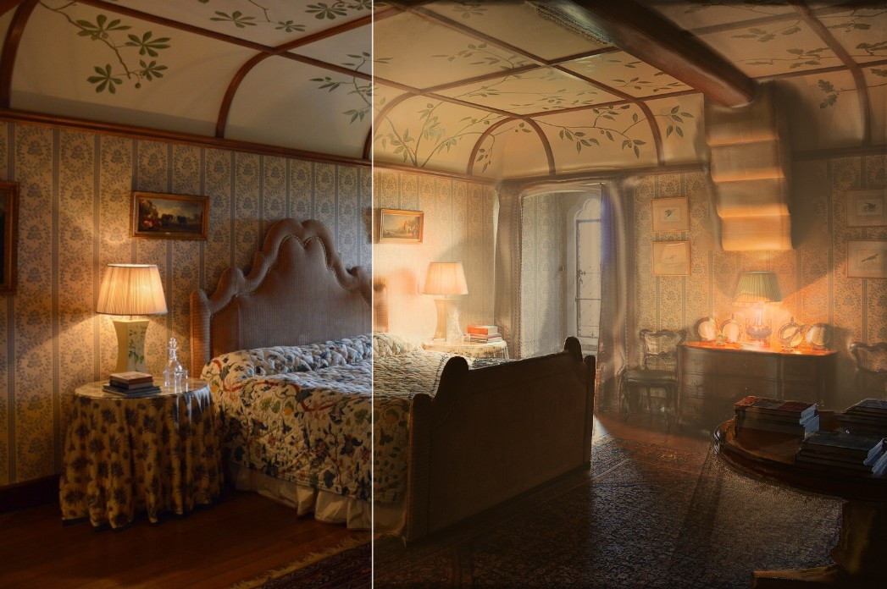
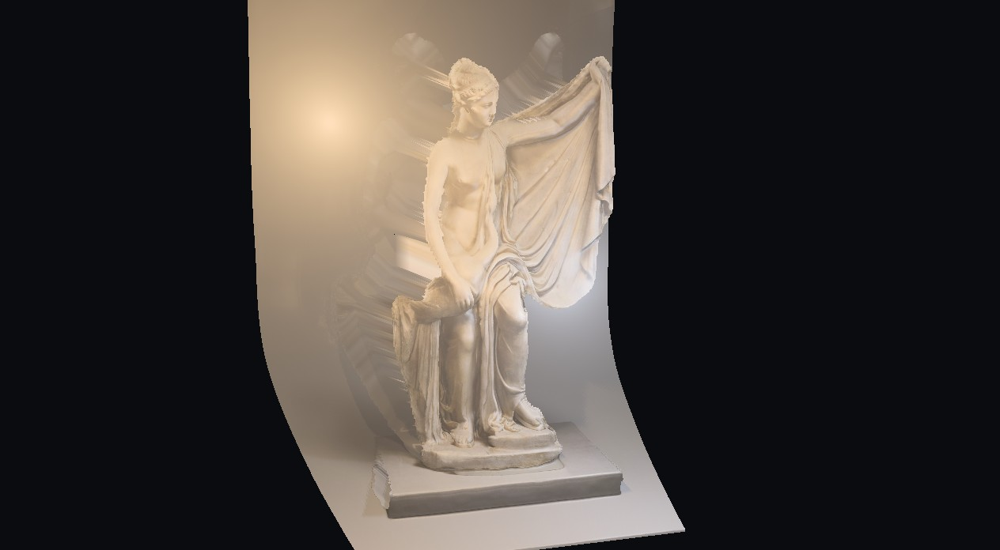
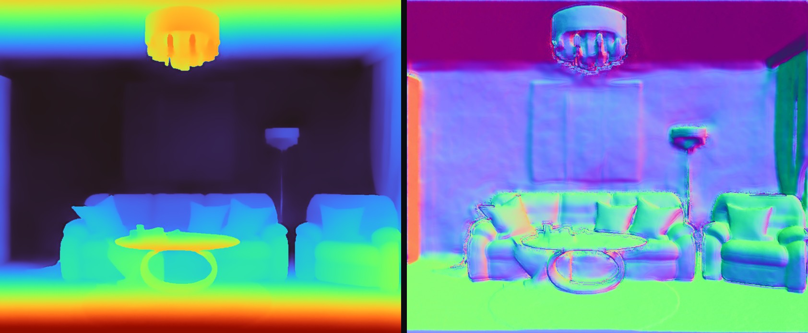

# Relight

**Light any photo again.** Drop in a photo: a neural network reconstructs it in 3D, a C++ engine
(compiled to WebAssembly) cleans the depth and builds a layered 3D scene, and WebGL2 shaders let
you place lamps that cast real shadows and glow, in real time, in your browser.

**[▶ Open the live demo](https://predragmilovanovic.github.io/Relight/)**: no install, nothing is
uploaded. Pick an example or use your own photo or your webcam.



*Every frame comes from one ordinary photo: AI depth, then C++ depth processing, then light,
shadow and glow from a lamp you can drag anywhere. This GIF was recorded by the app itself and
encoded by its C++ GIF encoder.*

| Before / after | Layered 3D from a single photo |
|---|---|
|  |  |

## How it works

```
photo ─► Depth Anything V2 (ONNX Runtime Web, WebGPU or WASM, Web Worker) ─► raw disparity
                                                                              │
      ┌──────────────── C++17 core → WebAssembly (core/) ───────────────────┘
      │ robust normalization · guided filter (denoise) · toggle-mapping edge sharpening
      │ illumination estimate (guided filter on log-luminance) · silhouette detection
      │ background layer (propagation inpainting) · grid meshes · lamp placement
      │ 4×4 matrices · depth file format · GIF encoder (median cut + LZW)
      ▼
   WebGL2 (shaders/*.glsl)
   pass 1  relight (cached)   depth → 3D position → edge-aware normals → per lamp:
                              inverse square + Lambert + Blinn-Phong + screen-space shadow ray
                              + closed-form volumetric glow; hue-preserving tone mapping
   pass 2  display            flat · before/after split · layered 3D relief with orbit camera
```

1. **AI depth.** [Depth Anything V2 Small](https://github.com/DepthAnything/Depth-Anything-V2) runs
   locally through [transformers.js](https://github.com/huggingface/transformers.js) in a Web
   Worker: WebGPU with fp16 weights when the GPU supports it, otherwise WebAssembly on the CPU.
2. **C++ depth processing.**
   - The raw prediction is normalized robustly, then denoised with a self-guided **guided
     filter**.
   - Network depth blurs every silhouette into a ramp several pixels wide. **Toggle-mapping
     sharpening** snaps those ramps back into steps, without touching smooth slopes such as floors.
3. **Layered 3D.** The C++ core finds silhouettes and builds a **background layer**: the foreground
   band next to each silhouette is removed and the background is grown into it from behind. In the
   3D view this layer fills what the foreground uncovers, so there are no holes and no "rubber
   sheets".
4. **Light.** Per pixel: inverse-square irradiance, Lambert and Blinn-Phong terms, and a shadow ray
   marched *through the depth map*, so anything in the photo shadows what is behind it. The glow of
   a lamp in haze has a closed form (an `atan`), so it costs no ray marching.
5. **Removing the photo's own light.** C++ estimates the illumination with an edge-preserving filter
   on log-luminance and divides it out, which leaves no halos around objects.

Equations and derivations: [docs/math.md](docs/math.md). Design and decisions:
[docs/architecture.md](docs/architecture.md).



## Highlights

| | |
|---|---|
| **C++ core in the browser** | About 1,450 lines of C++17 (guided filter, min/max filters, toggle mapping, propagation and push-pull inpainting, mesh building, camera model, matrices, median-cut + LZW GIF encoder) plus 650 lines of tests. Compiled to a 150 KB WebAssembly module with Embind. `-Wall -Wextra -Werror` under Emscripten, `/W4 /WX` under MSVC. |
| **Tested at both levels** | **30 GoogleTest tests** on the native build: closed forms vs numeric integration, brute-force references, a GIF round trip through an independent LZW decoder, synthetic scenes for every filter. **25 browser tests** on the real shaders and the real page. One command runs everything. |
| **Custom GPU pipeline** | Hand-written WebGL2 / GLSL ES 3.0: cached relight pass, sRGB-correct textures, 32-bit float depth, screen-space shadow rays, edge-aware normals, layered 3D mesh with polygon offset, GPU timer queries. No 3D engine. |
| **AI fully local** | ONNX Runtime Web with WebGPU (fp16) and automatic CPU fallback, in a Web Worker. The model is downloaded once and cached; no photo leaves the computer. |
| **Careful with the GPU** | **0 fps while idle** (tested). Lighting is cached, so orbiting costs one cheap draw. While dragging, a half-resolution preview takes 3–5 ms instead of 21–35 ms on an integrated GPU. [Performance](docs/performance.md) |
| **Zero build to host** | Static files; the WebAssembly bundle is committed. GitHub Pages serves the repository as is. |

## Run it locally

Requirements: Windows PowerShell and a recent Chrome or Edge (WebGL2; WebGPU optional).

```powershell
powershell -ExecutionPolicy Bypass -File scripts\serve.ps1
start http://localhost:8040
```

URL options: `?sample=statue|livingroom|bedroom|stilllife`, `?mode=split|3d|depth|normals`,
`?quality=low|medium|high`, `?device=wasm` (AI on the CPU).

## Build and test

Needs Visual Studio 2022 Build Tools (C++), CMake ≥ 3.24 and, to rebuild the WebAssembly module,
the [Emscripten SDK](https://emscripten.org/docs/getting_started/downloads.html) in `%USERPROFILE%\emsdk`.

```powershell
powershell -ExecutionPolicy Bypass -File scripts\build_wasm.ps1   # core/ -> js/relight_core.js
powershell -ExecutionPolicy Bypass -File scripts\test.ps1         # C++ + browser tests
```

`test.ps1` builds the native library and runs GoogleTest, then starts the local server and a
headless Chrome on [tests/](tests/). The page tests the WebAssembly bindings, renders a synthetic
scene with the real shaders and checks the pixels, then loads the app and checks its behaviour
(idle = 0 frames, no needless light passes, every example opens, GIF export, a clean console).

```
100% tests passed out of 30                     (GoogleTest)
25/25 browser tests passed in 4248 ms
All tests passed
```

Other tools: `scripts\bake.ps1` recomputes the examples' AI depth; `scripts\docs_images.ps1`
regenerates every image and the GIF in this README from the live app.

## Controls

| | |
|---|---|
| Drag a lamp | move it across the photo |
| Scroll on a lamp | move it deeper into the scene or closer to the camera |
| Double-click the photo | add a lamp (up to 4) |
| `Delete` | remove the selected lamp |
| `1`–`5` | Relit · Before/after · 3D · Depth · Normals |
| 3D view: drag / scroll | orbit (±13°) / zoom |
| Save image / Save animation | PNG of the relit photo / GIF of the lamp moving (or of the 3D view) |

## Repository layout

| Path | Contents |
|---|---|
| `core/include/relight`, `core/src` | C++17 core: `camera`, `depth`, `shading`, `layers`, `mesh`, `mat4`, `gif` |
| `core/tests` | GoogleTest suite |
| `core/wasm` | Embind bindings → `js/relight_core.js` (generated, committed) |
| `shaders/` | GLSL ES 3.0: `relight.frag`, `display.frag`, `mesh.vert/frag`, `common.glsl` |
| `js/` | `main.js` (UI, scheduling), `renderer.js` (WebGL2), `depth-worker.js` (AI), `shaders.js` (loader), `core.js`, `dev.js` |
| `tests/` | browser tests: bindings, GPU rendering, app behaviour |
| `scripts/` | `build_wasm.ps1`, `test.ps1`, `serve.ps1`, `bake.ps1`, `docs_images.ps1` |
| `samples/` | four CC0 example photos with cached depth ([credits](docs/samples.md)) |
| `docs/` | [math](docs/math.md), [architecture](docs/architecture.md), [performance](docs/performance.md), [samples](docs/samples.md) |

## Limitations

- **One view, relative depth.** A single photo cannot show what is behind objects, and monocular
  depth has no absolute scale. The background layer is a plausible guess, so the 3D view is limited
  to ±13° of parallax.
- **Screen-space shadows.** Only geometry visible in the photo casts shadows; thin objects can be
  missed when a ray steps over them (raise *Quality*).
- **Albedo is approximated.** The illumination estimate removes smooth, large-scale lighting;
  hard cast shadows in the original photo partly remain.
- **Direct light only.** No inter-reflections between surfaces.

## Credits

Depth model: Depth Anything V2 Small (Apache-2.0), ONNX export by
[onnx-community](https://huggingface.co/onnx-community/depth-anything-v2-small). Runtime:
transformers.js / ONNX Runtime Web. Guided filter: He, Sun, Tang, *Guided Image Filtering*
(ECCV 2010). Turbo colormap polynomial: Google (Apache-2.0). Example photos: CC0, from Wikimedia
Commons ([details](docs/samples.md)).
